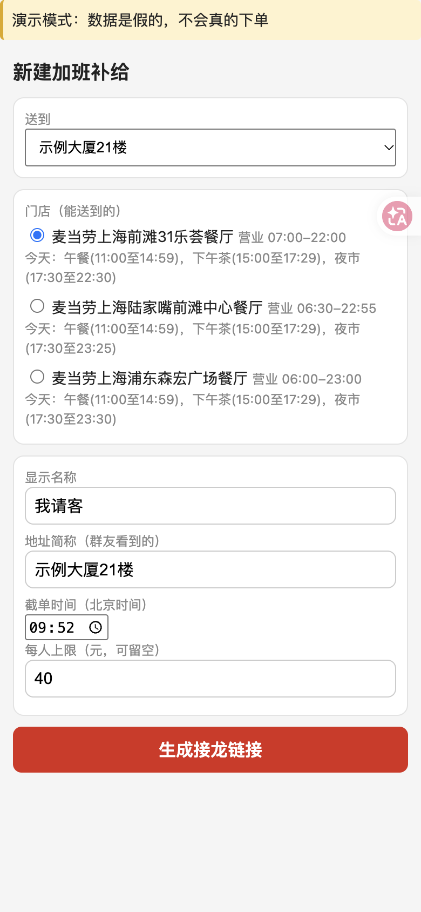
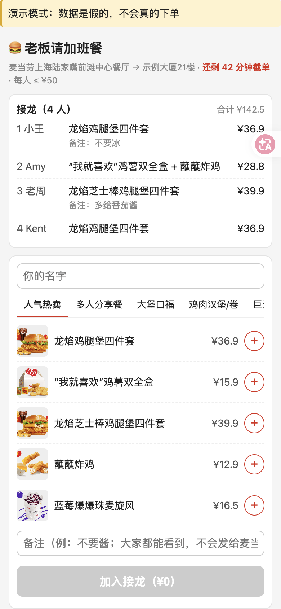
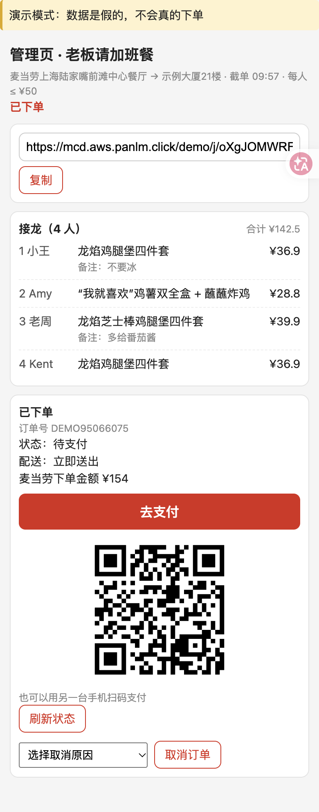

# 麦麦接龙

**加班点麦当劳，群里发个链接接龙，一个人请客合一单，省下 N 份配送费。**

发起人开一个团，把链接贴进群；同事点开就能接龙，不用装 AI 客户端、不用配 MCP、不用登录。到截单时间，发起人用自己的麦当劳账号把全团合成一单下单、送到公司。

> 本项目是个人参赛作品，**不是麦当劳官方产品**，与麦当劳公司没有隶属关系。它通过麦当劳官方开放的 MCP 服务（<https://open.mcd.cn/mcp>）工作。

- 在线演示（假数据，不会真的下单）：<https://mcd.aws.panlm.click/demo/host>
- 活动官方仓库（M-China）：<https://github.com/M-China/mcd-developer-innovation-challenge>
- 本项目仓库：<https://github.com/panlm/mcd-jielong>

## 为什么合成一单

实测示例（2026-10-14，上海某门店的 calculate-price 结果，以麦当劳实时价格为准）：

- 配送费每单 ¥6。
- 一单 16 件（6 份套餐 + 6 份麦乐鸡 + 4 杯奶铁），应付 ¥361.6，配送费只收一次 ¥6；如果拆成 12 单分开点，光配送费就要 12 × ¥6 = ¥72。
- 打包费有优惠，单品多时会封顶，但套餐多时不一定封顶，以麦当劳实时价格为准。

N 个人各点各的，要付 N 份配送费；合成一单，这 N 份都不用再各自付了，只由请客的人为合成的这一单付 1 份 ¥6。整体算下来，比各点各的少付 N−1 份配送费。

## 目标用户

- 晚上加班、想一起点一顿的团队。
- 想请同事吃饭、又不想一个个收菜单的发起人。

## 使用示例

三步：

1. **发起人开团**：选送餐地址和门店，填截单时间、每人上限（可不设）和显示名称，点「生成链接」，把链接贴到群里。

   

2. **群友接龙**：点开链接，选餐、写名字和备注，提交。会得到只存在这台手机上的改单凭证，截单前可以改或撤回。页面每 5 秒刷新一次接龙列表。

   

3. **发起人截单下单**：点「算价」看商品、配送费、打包费、优惠和应付；点「确认下单」并二次确认后提交。支付链接和二维码只显示在发起人的管理页，发起人付款即可。下单之前，发起人可以在管理页删掉重复或多余的接龙（删完要重新算价）。

   


没有 Token 也可以先在演示站走一遍（演示站是 mock 数据）。

## 自部署

环境：Python 3.12。

1. **申请 MCP Token**：到 <https://open.mcd.cn/mcp> 按官方流程申请，Token 只放在你自己的服务器上，不要提交到仓库。配置样例见 [`mcp-config.example.json`](mcp-config.example.json)。
2. **安装依赖**

   ```bash
   python3 -m venv .venv
   .venv/bin/pip install -r requirements.txt
   ```

3. **设置环境变量**

   | 变量 | 含义 |
   |---|---|
   | `MCD_MODE` | 必填。`real` 连真实 MCP，`demo` 用内置假数据（不需要 Token，也不会加载读取密钥的代码） |
   | `MCD_DB` | SQLite 文件路径，默认 `./data/real.db`（demo 为 `./data/demo.db`） |
   | `MCD_PUBLIC_BASE_URL` | 对外访问的地址，用来生成群链接，默认 `http://127.0.0.1:8001` |
   | `MCD_TOKEN_FILE` | real 模式必填：存放 MCP Token 的文件路径 |
   | `MCD_HOST_KEY` | real 模式必填：发起人页面的访问口令，自己生成一个随机串。`MCD_TOKEN_FILE` 和 `MCD_HOST_KEY` 两个都要设 |

   real 模式启动时把 Token 和口令读进内存，不写盘，不进日志。

4. **启动**

   ```bash
   # 本地试玩（假数据）
   MCD_MODE=demo .venv/bin/uvicorn app.main:app_from_env --factory --host 127.0.0.1 --port 8001

   # 真实模式
   MCD_MODE=real MCD_TOKEN_FILE=/path/to/token MCD_HOST_KEY=<自己生成的随机串> \
   MCD_PUBLIC_BASE_URL=https://your.domain \
   .venv/bin/uvicorn app.main:app_from_env --factory --host 127.0.0.1 --port 8000
   ```

   发起人用 `https://your.domain/host#k=<口令>` 打开管理页。口令放在 `#` 后面，浏览器不会把它发给服务器，所以不会出现在任何访问日志里。页面会先把它从地址栏去掉，再 POST 给服务器换成 HttpOnly cookie，这个 cookie 只发给 `/api/host`。

5. **Caddy 反代并自动签 HTTPS**

   ```caddyfile
   your.domain {
       reverse_proxy 127.0.0.1:8000
   }
   ```

   可以用 systemd 守护 uvicorn 进程。本项目线上用的完整配置（安全响应头、CSP、demo 进程的隔离设置）见 `deploy/` 目录。

6. **测试**

   ```bash
   .venv/bin/pip install -r requirements-dev.txt
   .venv/bin/python -m pytest -q
   ```

## 合规设计

对照《麦当劳 MCP 服务规则》：

- **凭证不外传（第二条第 2 款）**：Token 只在发起人自己的服务器上。群友只访问接龙页面，从不接触 MCP 和 Token。
- **不做代下单牟利（第六条第 1 款）**：发起人用自己的账号请客，本项目不收服务费、不收款、不加价，也不做 AA 收款。
- **不用自动化脚本调用（第六条第 2 款）**：每一次 MCP 调用都由发起人的一次点击触发，只有 9 个白名单 tool，没有定时任务和后台轮询。群友的请求、页面刷新、服务启动、健康检查都不调用 MCP。
- **不批量、不高频（第三条第 2 款）**：一次开团大约 10–20 次调用。
- **防止重复下单**：`create-order` 超时或结果不明时，整个团锁在「待确认」状态，发起人先「查最近订单」确认后才能继续；连点或开两个标签页只会发出一次。
- **群页面不泄露隐私**：群页面里没有支付链接、地址 id、手机号和联系人姓名。群友的备注只显示，不发给麦当劳。
- **页面安全**：前端渲染用户输入一律用 `textContent`，页面没有内联脚本和样式，配合严格的 CSP；群友的写接口按 IP 限流（每分钟 120 次，照顾同一办公室共用一个出口 IP 的情况），口令输错也按 IP 限流，但输对口令的发起人不会被别人锁在外面；每人可设上限，每个团最多 50 条接龙。
- **发起人接口防跨站伪造**：`/api/host/*` 只接受本站页面发来、带自定义请求头 `X-Requested-With` 的请求，浏览器标明来自其他站点（`Sec-Fetch-Site` 不是 `same-origin`）的一律拒绝，别的网站没法借发起人的浏览器触发 MCP 调用。发起人 cookie 只发给 `/api/host`。
- **公开演示站和真实实例隔离**：演示站是同一台服务器上的另一个进程，只用内置假数据，环境里没有 Token，也不加载读取密钥的代码。它以单独的系统用户运行，读不到真实实例的数据目录；systemd 禁止它访问云主机的实例元数据服务，所以拿不到服务器的云凭证，也就读不到存放 Token 的参数。发起人的登录 cookie 不会发到 `/demo/` 下。这些是进程和权限层面的隔离，两者仍共用同一台机器和同一份代码。

白名单里每个 tool 由哪个页面、哪个操作触发，见 [MCP_INTEGRATION.md](MCP_INTEGRATION.md)。

## 项目结构

```
app/
  main.py         FastAPI 应用工厂（real / demo 两种模式）
  mcp_client.py   MCP 客户端、tool 白名单、mock 客户端
  host_api.py     发起人接口：开团、算价、下单、刷新、取消
  member_api.py   群友接口：查看团、接龙、改单、撤回（不调 MCP）
  group.py        接龙校验与团状态
  store.py        SQLite 存储
  security.py     鉴权、限流、日志脱敏
  money.py        金额换算（内部一律用整数分）
  mock_data/      demo 用的脱敏样本
web/              静态 HTML + 原生 JS 前端
deploy/           Caddy、systemd 配置和部署脚本（部署目标从环境变量或不入库的 deploy/deploy.env 读取）
tests/            单元与流程测试
CONTEST_DECLARATION.md   参赛声明（官方原文）
MCP_INTEGRATION.md       MCP 接入说明
mcp-config.example.json  MCP 配置样例（只有环境变量占位符）
```

## 声明

本项目是个人参赛作品，不是麦当劳官方产品。价格、优惠和配送规则以麦当劳实时结果为准。
